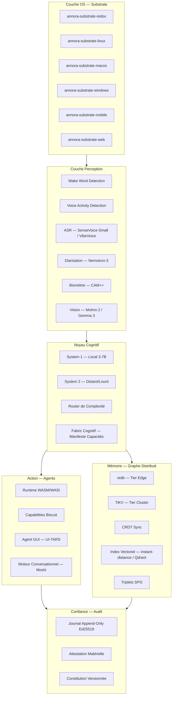
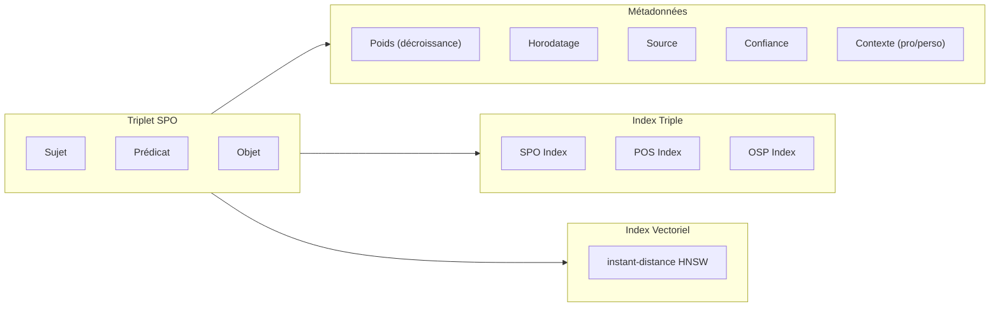
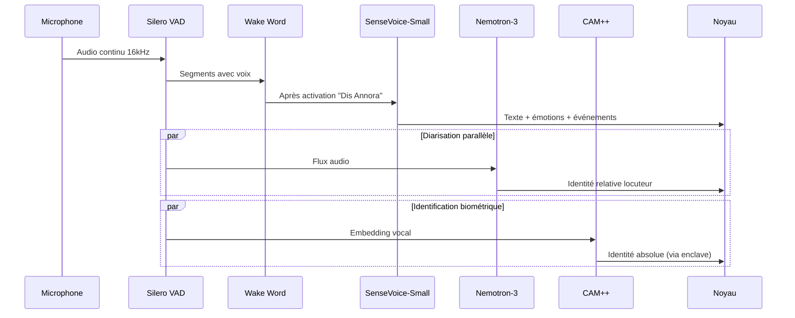

# Plan d'Implémentation Complet — Annora

## Système d'Exploitation Cognitif Souverain

> *"Un système d'exploitation cognitif, pas un chatbot."*

---

## Synthèse de la Vision

Annora est un **OS cognitif** — une couche système qui pense en continu à côté de l'utilisateur, agit dans un périmètre qu'il contrôle, et ne l'oublie jamais entre deux sessions (car il n'y a plus de sessions). L'architecture repose sur **6 couches** (OS → Perception → Noyau cognitif → Mémoire → Action → Confiance), toutes écrites en **Rust pur**, communiquant par messages typés.

### Trois critères non négociables
1. **Continuité** — pas de fil de conversation, un fil de vie
2. **Initiative bornée** — le système agit dans un périmètre défini, révisable
3. **Généralité pratique** — coder, planifier, piloter, rédiger : sans changer d'application

### Trois paliers matériels (Tiers)
- **Tier Souverain** : Station dédiée Redox/Linux, hub domestique — contrôle total
- **Tier Natif** : Laptop Linux/macOS/Windows — contrôle quasi total
- **Tier Invité** : Mobile Android/iOS/Web — capacités réduites, "ombre" cloud

---

## User Review Required

> [!IMPORTANT]
> **Scope de la Phase 0** : Ce plan implémente la **Phase 0 complète** telle que décrite dans la roadmap (section 11) : noyau cognitif + mémoire graphe (tier edge seul), mono-appareil, aucun agent actif avec actions système. Cependant, nous construisons **toutes les fondations architecturales** des phases suivantes pour qu'elles s'intègrent naturellement. Les phases 1-3 sont définies en détail dans le plan mais leur implémentation suit le plan de la Phase 0.

> [!WARNING]
> **Pas de Python en production** : Toute l'inférence passe par Candle, ONNX Runtime (`ort` crate) ou FFI C pure. Aucune exception.

> [!IMPORTANT]
> **Modèles IA** : L'implémentation initiale utilisera des **stubs/mocks** pour les modèles d'inférence (SenseVoice-Small, Moshi, UI-TARS, etc.). Le chargement réel des poids nécessite le téléchargement des modèles (~8-20 Go). Le code de chargement et d'inférence sera complet et fonctionnel, mais testé d'abord avec des données synthétiques.

---

## Open Questions

> [!IMPORTANT]
> **Q1 — Cible de compilation initiale** : Le développement se fait sous Windows. Voulez-vous que la première cible compilable soit `annora-substrate-windows` avec un portage Linux/Redox ultérieur ? Ou préférez-vous cibler Linux (WSL2) dès le départ ?

> [!IMPORTANT]
> **Q2 — Interface utilisateur Phase 0** : La section 13 décrit un design minimaliste (point dans la barre système, voix d'abord). Pour Phase 0, voulez-vous une interface CLI pure, ou un début d'interface graphique avec le point de présence minimale ?

> [!IMPORTANT]
> **Q3 — Modèles de raisonnement** : Le document de sélection recommande Qwen3-8B pour System 1. Voulez-vous intégrer directement l'inférence locale via Candle/GGUF dans Phase 0, ou utiliser une API locale (type Ollama/llama.cpp server) comme pont temporaire pendant qu'on construit l'inférence native ?

---

## Architecture Globale



---

## Proposed Changes

### Structure du Monorepo Cargo Workspace

> La structure suit exactement la section 15 du document de vision, enrichie des composants identifiés dans les 36 sections.

#### [NEW] Structure complète du projet

```
annora/
├── Cargo.toml                          # Workspace root
├── Cargo.lock
├── rust-toolchain.toml
├── .cargo/
│   └── config.toml                     # Profils de compilation, targets
├── deny.toml                           # cargo-deny config
├── LICENSE-APACHE                      # Apache 2.0 pour crates edge/client
├── LICENSE-AGPL                        # AGPL pour composants serveur
├── README.md
│
├── crates/
│   ├── annora-core/                    # Types fondamentaux partagés
│   │   ├── Cargo.toml
│   │   └── src/
│   │       ├── lib.rs
│   │       ├── types.rs                # Types de base (Timestamp, UserId, etc.)
│   │       ├── capability.rs           # Tokens Biscuit, atténuation, algèbre
│   │       ├── crypto.rs               # Ed25519, chiffrement, clés
│   │       ├── error.rs                # Types d'erreur unifiés
│   │       ├── config.rs               # Configuration globale, manifestes
│   │       ├── message.rs              # Messages typés inter-composants
│   │       └── trust.rs                # Niveaux de confiance, tags untrusted
│   │
│   ├── annora-kernel/                  # Noyau cognitif, routing S1/S2
│   │   ├── Cargo.toml
│   │   └── src/
│   │       ├── lib.rs
│   │       ├── fabric.rs               # Fabric cognitif — capacités, manifeste
│   │       ├── router.rs               # Routeur S1/S2 (appris, pas codé en dur)
│   │       ├── system1.rs              # Moteur local, latence sub-100ms
│   │       ├── system2.rs              # Slot distant, BYOM
│   │       ├── orchestrator.rs         # Orchestration des capacités
│   │       ├── context.rs              # Contexte d'interaction continu
│   │       ├── confidence.rs           # Calcul seuils confiance (§20a)
│   │       ├── contradiction.rs        # Auto-critique interne (§33e)
│   │       ├── priority.rs             # Hiérarchie instructions (§34b)
│   │       └── budget.rs               # Budget de latence par étage
│   │
│   ├── annora-memory/                  # Graphe, encodage triplets SPO
│   │   ├── Cargo.toml
│   │   └── src/
│   │       ├── lib.rs
│   │       ├── triplet.rs              # SPO avec métadonnées (poids, horodatage, source, confiance)
│   │       ├── graph.rs                # Graphe en mémoire, traversée SPO/POS/OSP
│   │       ├── storage/
│   │       │   ├── mod.rs
│   │       │   ├── edge.rs             # Backend redb
│   │       │   └── cluster.rs          # Backend TiKV (stub Phase 0)
│   │       ├── vector/
│   │       │   ├── mod.rs
│   │       │   ├── edge.rs             # instant-distance HNSW
│   │       │   └── cluster.rs          # Qdrant (stub Phase 0)
│   │       ├── decay.rs                # Décroissance temporelle des poids
│   │       ├── contradiction.rs        # Résolution de contradictions (§26a)
│   │       ├── context_partition.rs    # Partitions pro/perso (§35b)
│   │       ├── heritage.rs             # Crépuscule numérique, effacement crypto (§19f)
│   │       ├── export.rs               # Format ouvert d'export (§26f)
│   │       └── objective.rs            # Nœuds Objectif longue durée (§26d)
│   │
│   ├── annora-substrate/               # Traits Substrate + Compute (contrats)
│   │   ├── Cargo.toml
│   │   └── src/
│   │       ├── lib.rs
│   │       ├── substrate.rs            # Trait Substrate principal
│   │       ├── compute.rs              # Trait Compute (orthogonal à l'OS)
│   │       ├── manifest.rs             # Manifeste de capacités matérielles (§3ter.1)
│   │       └── attestation.rs          # Attestation de confiance, signatures (§3ter.3)
│   │
│   ├── annora-substrate-linux/
│   │   ├── Cargo.toml
│   │   └── src/
│   │       ├── lib.rs
│   │       ├── daemon.rs               # Daemon privilégié
│   │       ├── seccomp.rs              # seccomp + namespaces
│   │       └── input.rs                # Injection d'entrée sandboxée
│   │
│   ├── annora-substrate-windows/
│   │   ├── Cargo.toml
│   │   └── src/
│   │       ├── lib.rs
│   │       ├── service.rs              # Service Windows
│   │       └── appcontainer.rs         # AppContainer sandboxing
│   │
│   ├── annora-substrate-macos/
│   │   ├── Cargo.toml
│   │   └── src/
│   │       └── lib.rs                  # Sandbox.framework + Endpoint Security
│   │
│   ├── annora-substrate-redox/
│   │   ├── Cargo.toml
│   │   └── src/
│   │       └── lib.rs                  # Schemes Redox natifs
│   │
│   ├── annora-substrate-mobile/
│   │   ├── Cargo.toml
│   │   └── src/
│   │       └── lib.rs                  # Android/iOS scoped storage
│   │
│   ├── annora-substrate-web/
│   │   ├── Cargo.toml
│   │   └── src/
│   │       └── lib.rs                  # WASM navigateur
│   │
│   ├── annora-perception/              # Pipeline de perception multimodale
│   │   ├── Cargo.toml
│   │   └── src/
│   │       ├── lib.rs
│   │       ├── audio/
│   │       │   ├── mod.rs
│   │       │   ├── capture.rs          # Capture audio continue
│   │       │   ├── wake_word.rs        # openWakeWord via ONNX
│   │       │   ├── vad.rs              # Silero VAD
│   │       │   ├── asr.rs              # Trait ASR + impls SenseVoice/VibeVoice
│   │       │   ├── diarization.rs      # Nemotron-3 diarisation
│   │       │   └── speaker_id.rs       # CAM++ embeddings biométriques
│   │       ├── vision/
│   │       │   ├── mod.rs
│   │       │   ├── capture.rs          # Capture caméra continue
│   │       │   ├── scene.rs            # World model, état de situation
│   │       │   └── grounding.rs        # GUI grounding pour UI-TARS
│   │       └── world_model.rs          # État persistant de situation (§6)
│   │
│   ├── annora-inference/               # Runtimes d'inférence unifiés
│   │   ├── Cargo.toml
│   │   └── src/
│   │       ├── lib.rs
│   │       ├── candle_runtime.rs       # Runtime Candle pour Moshi, LLMs
│   │       ├── onnx_runtime.rs         # Runtime ONNX via `ort` crate
│   │       ├── gguf_runtime.rs         # Chargement modèles GGUF
│   │       ├── model_registry.rs       # Registre des modèles chargés
│   │       └── quantization.rs         # Utilitaires quantisation INT8/Q4
│   │
│   ├── annora-voice/                   # Interaction vocale
│   │   ├── Cargo.toml
│   │   └── src/
│   │       ├── lib.rs
│   │       ├── moshi.rs                # Moshi full-duplex via Candle Rust
│   │       ├── tts.rs                  # CosyVoice2 / NeuTTS Air
│   │       ├── codec.rs                # Codec Mimi
│   │       └── barge_in.rs             # Gestion interruptions naturelles
│   │
│   ├── annora-agents/                  # Runtime WASM/WASI, capabilities
│   │   ├── Cargo.toml
│   │   └── src/
│   │       ├── lib.rs
│   │       ├── runtime.rs              # Runtime WASM/WASI (wasmtime)
│   │       ├── capability.rs           # Vérification capabilities Biscuit
│   │       ├── sandbox.rs              # Isolation, permissions
│   │       ├── gui_agent.rs            # Agent GUI — UI-TARS encapsulé
│   │       ├── registry.rs             # Registre agents installés
│   │       └── protocol.rs             # Protocole inter-agents (§19a)
│   │
│   ├── annora-audit/                   # Journal signé, attestation
│   │   ├── Cargo.toml
│   │   └── src/
│   │       ├── lib.rs
│   │       ├── journal.rs              # Append-only log, signé Ed25519
│   │       ├── entry.rs                # Entrée d'audit avec trace de raisonnement (§19i)
│   │       ├── attestation.rs          # TPM/Secure Enclave
│   │       └── query.rs               # Requêtes sur le journal, "pourquoi"
│   │
│   ├── annora-sync/                    # CRDT edge↔cluster
│   │   ├── Cargo.toml
│   │   └── src/
│   │       ├── lib.rs
│   │       ├── crdt.rs                 # Grow-only sets + tombstones
│   │       ├── replication.rs          # Réplication chiffrée multi-région (§19j)
│   │       ├── handoff.rs              # Continuité cross-device (§21e)
│   │       └── protocol.rs             # Protocole sync ouvert (§22a)
│   │
│   ├── annora-auth/                    # Authentification multi-utilisateurs
│   │   ├── Cargo.toml
│   │   └── src/
│   │       ├── lib.rs
│   │       ├── enrollment.rs           # Enrôlement voix/visage
│   │       ├── continuous.rs           # Authentification continue (§30a)
│   │       ├── household.rs            # Multi-utilisateurs foyer (§19d)
│   │       ├── minor.rs                # Profils mineurs (§26c)
│   │       └── wallet.rs               # Wallet capability (§19e)
│   │
│   ├── annora-constitution/            # Constitution versionnée
│   │   ├── Cargo.toml
│   │   └── src/
│   │       ├── lib.rs
│   │       ├── rules.rs                # Règles constitutionnelles
│   │       ├── governance.rs           # Gouvernance externe (§19h)
│   │       └── ethics.rs               # Batterie dilemmes éthiques (§26e)
│   │
│   ├── annora-ui/                      # Interface minimale (§13)
│   │   ├── Cargo.toml
│   │   └── src/
│   │       ├── lib.rs
│   │       ├── presence.rs             # Point de présence (veille/écoute/action)
│   │       ├── journal_view.rs         # Vue journal d'audit navigable
│   │       ├── onboarding.rs           # Onboarding : limites avant capacités
│   │       ├── cost_display.rs         # Coût en direct (§24c)
│   │       └── accessibility.rs        # Reconfiguration capacités (§21g)
│   │
│   └── annora-metrics/                 # Métriques internes (§24b)
│       ├── Cargo.toml
│       └── src/
│           ├── lib.rs
│           ├── continuity.rs           # Taux tâches sans re-explication
│           ├── bounded_initiative.rs   # Taux propositions bornées
│           ├── generality.rs           # Diversité types de tâches
│           └── drift.rs               # Détection dérive valeurs (§26e)
│
├── agents/                             # Agents WASM de référence (Phase 1)
│   ├── mail/
│   ├── calendar/
│   ├── code/
│   ├── home/                           # Domotique
│   └── wallet-readonly/                # Paiement lecture seule
│
├── xtask/                              # Tooling de build custom
│   ├── Cargo.toml
│   └── src/
│       └── main.rs
│
├── conformance/                        # Suite de conformance obligatoire
│   ├── Cargo.toml
│   └── src/
│       ├── lib.rs
│       ├── substrate_tests.rs          # Tests chaque Substrate
│       ├── capability_tests.rs         # Property-based tests capabilities
│       └── cognitive_tests.rs          # Tests conformance cognitive
│
├── constitution/                       # Constitution versionnée
│   ├── v1.0.md
│   └── CHANGELOG.md
│
├── adr/                                # Architecture Decision Records
│   └── 001-rust-only-no-python.md
│
└── manifests/                          # Manifestes Fabric cognitif par Tier
    ├── sovereign.toml
    ├── native.toml
    └── guest.toml
```

---

### Composant 1 : `annora-core` — Types Fondamentaux

> Le socle partagé par tous les crates. Aucune dépendance vers les autres crates Annora.

#### [NEW] `crates/annora-core/Cargo.toml`

```toml
[package]
name = "annora-core"
version = "0.1.0"
edition = "2024"
license = "Apache-2.0"
description = "Core types and primitives for Annora cognitive OS"

[dependencies]
serde = { version = "1", features = ["derive"] }
serde_json = "1"
biscuit-auth = "5"
ed25519-dalek = { version = "2", features = ["serde"] }
chacha20poly1305 = "0.10"
rand = "0.9"
thiserror = "2"
chrono = { version = "0.4", features = ["serde"] }
uuid = { version = "1", features = ["v7", "serde"] }
tracing = "0.1"
tokio = { version = "1", features = ["full"] }
bytes = "1"
```

#### Contenu clé — `capability.rs`
Implémente l'algèbre des capabilities Biscuit :
- Création de tokens root avec keypair Ed25519
- Atténuation hors-ligne (chaque délégation → token strictement plus restreint)
- Vérification : action demandée ⊆ capabilities accordées
- Expiration temporelle native
- Catégories : `filesystem`, `network`, `gui_input`, `wallet`, `sensor`, `model_inference`

#### Contenu clé — `message.rs`
Système de messages typés inter-composants avec tags `TrustLevel` :
- `TrustLevel::System` — produit par le noyau
- `TrustLevel::User` — produit par l'utilisateur authentifié
- `TrustLevel::Untrusted` — contenu externe (email, web) — **ne peut JAMAIS devenir instruction**
- `TrustLevel::Guest` — session invité, pas d'apprentissage LoRA

---

### Composant 2 : `annora-substrate` — Trait d'Abstraction OS

> Le contrat que chaque OS doit implémenter. Jamais le noyau ne connaît l'OS sous-jacent.

#### [NEW] `crates/annora-substrate/src/substrate.rs`

```rust
/// Le contrat fondamental entre Annora et sa machine hôte.
/// Chaque OS implémente ce trait dans un crate séparé.
#[async_trait]
pub trait Substrate: Send + Sync + 'static {
    /// Manifeste décrivant les capacités de cette plateforme
    fn manifest(&self) -> &PlatformManifest;
    
    /// Attestation signée du manifeste via enclave matérielle
    async fn attest(&self, data: &[u8]) -> Result<SignedAttestation>;
    
    // --- Filesystem ---
    async fn read_file(&self, path: &VirtualPath, cap: &CapabilityToken) -> Result<Vec<u8>>;
    async fn write_file(&self, path: &VirtualPath, data: &[u8], cap: &CapabilityToken) -> Result<()>;
    
    // --- Network ---
    async fn http_request(&self, req: HttpRequest, cap: &CapabilityToken) -> Result<HttpResponse>;
    
    // --- Audio ---
    fn audio_capture_stream(&self, cap: &CapabilityToken) -> Result<AudioStream>;
    fn audio_playback_sink(&self, cap: &CapabilityToken) -> Result<AudioSink>;
    
    // --- Display ---
    async fn capture_screen(&self, cap: &CapabilityToken) -> Result<ScreenCapture>;
    async fn inject_input(&self, action: InputAction, cap: &CapabilityToken) -> Result<()>;
    
    // --- Sensors ---
    async fn sensor_data(&self, sensor: SensorType, cap: &CapabilityToken) -> Result<SensorReading>;
    
    // --- Process ---
    async fn spawn_sandboxed(&self, wasm: &[u8], caps: Vec<CapabilityToken>) -> Result<ProcessHandle>;
    
    // --- Power ---
    fn power_state(&self) -> PowerState;
    fn thermal_state(&self) -> ThermalState;
}

/// Trait orthogonal pour les backends de calcul
#[async_trait]
pub trait Compute: Send + Sync + 'static {
    /// Backends disponibles (CUDA, Metal, CPU, NPU, WebGPU)
    fn available_backends(&self) -> Vec<ComputeBackend>;
    fn preferred_backend(&self) -> ComputeBackend;
    fn vram_available(&self) -> u64;
    fn ram_available(&self) -> u64;
}
```

---

### Composant 3 : `annora-memory` — Graphe Distribué de Connaissance

> Cœur de l'identité de l'utilisateur. Tout vit ici, jamais dans les poids des modèles.

#### Architecture du graphe



#### Encodage des triplets

```rust
/// Un fait dans le graphe de connaissances.
#[derive(Debug, Clone, Serialize, Deserialize)]
pub struct Triplet {
    pub id: TripletId,
    pub subject: NodeId,
    pub predicate: PredicateId,
    pub object: NodeValue,
    pub metadata: TripletMetadata,
}

#[derive(Debug, Clone, Serialize, Deserialize)]
pub struct TripletMetadata {
    pub weight: f64,           // Décroissance temporelle
    pub created_at: Timestamp,
    pub last_activated: Timestamp,
    pub source: TripletSource, // User, System, Inferred, External
    pub confidence: f64,       // 0.0 - 1.0
    pub context: ContextPartition, // Pro, Personal, Shared, Default
    pub trust_level: TrustLevel,
}

/// Types de nœuds spécialisés (§26d)
pub enum NodeType {
    Fact,       // Fait simple
    Entity,     // Personne, lieu, objet
    Objective,  // Objectif longue durée avec jalons
    Preference, // Préférence utilisateur
    Skill,      // Compétence acquise/reconnue
}
```

#### Backend redb (Tier Edge)

```rust
pub struct EdgeStore {
    db: redb::Database,
    // Tables pour les 3 index
    spo_table: redb::TableDefinition<'static, &[u8], &[u8]>,
    pos_table: redb::TableDefinition<'static, &[u8], &[u8]>,
    osp_table: redb::TableDefinition<'static, &[u8], &[u8]>,
}

impl EdgeStore {
    /// Insère un triplet avec résolution de contradiction (§26a)
    pub async fn insert(&self, triplet: Triplet) -> Result<InsertResult> {
        // 1. Vérifier contradiction avec faits existants
        // 2. Si contradiction : comparer fraîcheur + confiance
        // 3. Si écart trop grand : retourner NeedsUserResolution
        // 4. Sinon : insérer, ne jamais écraser silencieusement
    }
    
    /// Recherche par traversée de graphe
    pub async fn query(&self, pattern: TriplePattern) -> Result<Vec<Triplet>> { ... }
    
    /// Décroissance temporelle batch (planifiée)
    pub async fn apply_decay(&self, decay_rate: f64) -> Result<u64> { ... }
}
```

#### Index vectoriel — `instant-distance`

```rust
pub struct VectorIndex {
    hnsw: HnswMap<Embedding, TripletId>,
}

impl VectorIndex {
    /// Recherche sémantique locale (§27b)
    pub fn search(&self, query: &Embedding, k: usize) -> Vec<(TripletId, f32)> { ... }
    
    /// Ajout d'embedding pour un triplet
    pub fn insert(&mut self, id: TripletId, embedding: Embedding) { ... }
}
```

---

### Composant 4 : `annora-kernel` — Noyau Cognitif

> Le cerveau. Routing System 1/System 2, Fabric cognitif, orchestration.

#### Fabric Cognitif (§17bis)

```rust
/// Le Fabric ne référence jamais un modèle par nom.
/// Il référence des CAPACITÉS, backées par des modèles interchangeables.
#[derive(Debug, Clone, Deserialize)]
pub struct CognitiveManifest {
    pub capabilities: HashMap<CapabilityName, CapabilityBinding>,
}

#[derive(Debug, Clone, Deserialize)]
pub struct CapabilityBinding {
    pub model_ref: ModelReference,
    pub runtime: RuntimeType,      // Candle, ONNX, GGUF
    pub quantization: Option<Quantization>,
    pub max_memory_mb: u64,
    pub loading_strategy: LoadingStrategy, // AlwaysResident, OnDemand, Paged
}

/// Noms canoniques des capacités
pub enum CapabilityName {
    Listen,      // Écouter — ASR
    See,         // Voir — Vision
    Speak,       // Parler — TTS
    ActGui,      // Agir-GUI — Computer Use
    Reason,      // Raisonner — LLM
    ReasonHeavy, // Raisonner-lourd — System 2 (BYOM)
    Identify,    // Identifier — Biométrie
    Diarize,     // Diariser — Séparation locuteurs
}
```

**Détection automatique de fusion** : Quand plusieurs capacités pointent vers le même `model_ref`, le Fabric court-circuite les sérialisations intermédiaires — latence réduite gratuitement.

#### Router S1/S2 (§4)

```rust
pub struct CognitiveRouter {
    /// Classifieur de complexité (modèle minuscule, pas heuristique)
    complexity_classifier: Box<dyn ComplexityClassifier>,
    /// Seuils appris, pas codés en dur
    routing_policy: RoutingPolicy,
}

impl CognitiveRouter {
    pub async fn route(&self, input: &CognitiveInput) -> RoutingDecision {
        let complexity = self.complexity_classifier.classify(input).await;
        let entropy = self.measure_system1_entropy(input).await;
        
        if complexity.score < self.routing_policy.s1_threshold 
           && entropy < self.routing_policy.entropy_threshold {
            RoutingDecision::System1
        } else {
            RoutingDecision::System2 {
                estimated_cost: self.estimate_cost(input),
                reason: complexity.explanation,
            }
        }
    }
}
```

#### Gestion de la confiance (§20a, §33e)

```rust
pub struct ConfidenceEngine {
    /// Seuil en dessous duquel on passe en "propose et attends"
    auto_act_threshold: f64,
    /// Seuils spéciaux pour juridique/financier/médical (§35c)
    domain_thresholds: HashMap<Domain, f64>,
}

impl ConfidenceEngine {
    pub fn evaluate(&self, action: &ProposedAction, graph_corroboration: f64) -> ConfidenceResult {
        let model_confidence = action.model_confidence;
        let combined = (model_confidence * 0.6) + (graph_corroboration * 0.4);
        let domain = action.classify_domain();
        let threshold = self.domain_thresholds.get(&domain)
            .unwrap_or(&self.auto_act_threshold);
        
        if combined > *threshold {
            ConfidenceResult::AutoExecute
        } else if combined > threshold * 0.7 {
            // Zone limite : auto-critique interne (§33e)
            ConfidenceResult::InternalContradiction
        } else {
            ConfidenceResult::ProposeAndWait
        }
    }
}
```

---

### Composant 5 : `annora-perception` — Pipeline Audio & Vision

> Condensation du pipeline audio selon le document de sélection des modèles.

#### Pipeline audio



#### Implémentation SenseVoice-Small

```rust
/// SenseVoice-Small : 234M params, non-autorégressif
/// RTF ~0.02 GPU, ~0.08 CPU. 229 Mo INT8.
/// Via sherpa-onnx Rust crate.
pub struct SenseVoiceSmall {
    recognizer: sherpa_onnx::OnlineRecognizer,
}

impl AudioPerception for SenseVoiceSmall {
    /// Résultat multi-tâches en une seule inférence :
    /// - Transcription (zh, en, ja, ko, cantonais)
    /// - Détection d'activité vocale implicite
    /// - Identification de langue
    /// - Émotions vocales
    /// - Événements sonores (toux, rire, musique)
    async fn process(&self, audio: &AudioChunk) -> PerceptionResult { ... }
}
```

---

### Composant 6 : `annora-voice` — Interaction Full-Duplex Moshi

> Moteur conversationnel System 1 — Moshi via Candle Rust natif.

```rust
/// Moshi : ~7.6B params, full-duplex, latence ~200ms
/// Implémentation Rust native via Candle (kyutai-labs/moshi/rust/)
pub struct MoshiEngine {
    temporal_transformer: candle::Model,  // 7B — dépendances sémantiques
    depth_transformer: candle::Model,     // ~0.6B — codebooks acoustiques
    mimi_codec: MimiCodec,               // Codec neuronal 12.5 Hz
}

impl MoshiEngine {
    /// Dialogue parallèle : traite ET produit deux flux simultanément
    /// - user_audio : flux capté par le micro
    /// - system_audio : flux généré par le système
    pub async fn full_duplex_step(
        &mut self,
        user_audio: &AudioFrame,
    ) -> MoshiOutput {
        // 1. Encoder user_audio via Mimi (80ms latence de trame)
        // 2. Inner Monologue : projeter tokens textuels avant acoustiques
        // 3. Générer tokens acoustiques via Depth Transformer
        // 4. Décoder via Mimi inverse
        // Latence théorique : 160ms (80ms codec + 80ms acoustique)
    }
    
    /// Injection de contexte RAG depuis System 2 (§ MoshiRAG)
    pub async fn inject_context(&mut self, context: &str) { ... }
}
```

---

### Composant 7 : `annora-agents` — Runtime WASM Sandboxé

> Chaque agent tourne en WASM/WASI avec capabilities explicites.

```rust
pub struct AgentRuntime {
    engine: wasmtime::Engine,
    linker: wasmtime::Linker<AgentState>,
}

impl AgentRuntime {
    /// Un agent ne reçoit JAMAIS de capabilities plus larges que son parent
    pub async fn spawn(
        &self,
        wasm_binary: &[u8],
        capabilities: Vec<CapabilityToken>,
        parent_cap: &CapabilityToken,
    ) -> Result<AgentHandle> {
        // Vérification : capabilities ⊆ parent_cap (garanti par Biscuit)
        for cap in &capabilities {
            verify_attenuation(parent_cap, cap)?;
        }
        // ...
    }
}
```

#### Agent GUI — UI-TARS encapsulé (§ médiation capabilities)

```rust
/// UI-TARS 7B-DPO : perception visuelle pure, pas d'arbre DOM
/// Encapsulé en WASM, ses prédictions sont des INTENTIONS, pas des appels système
pub struct GuiAgent {
    model: UiTarsModel,
}

impl GuiAgent {
    /// Prédit une action GUI à partir d'une capture d'écran
    /// Retourne une INTENTION typée, pas un appel système direct
    pub async fn predict_action(&self, screenshot: &ScreenCapture, task: &str) -> GuiIntention {
        // Le modèle prédit des coordonnées et une action
        // Mais c'est une INTENTION qui sera validée par annora-kernel
    }
}

/// Intentions typées — jamais des appels système directs
pub enum GuiIntention {
    Click { x: f32, y: f32, button: MouseButton },
    Type { text: String },
    Hotkey { keys: Vec<Key> },
    Scroll { direction: ScrollDirection, amount: f32 },
    Drag { from: (f32, f32), to: (f32, f32) },
}
```

---

### Composant 8 : `annora-audit` — Journal Signé Append-Only

> Chaque action génère une entrée signée Ed25519, consultable, annulable.

```rust
#[derive(Debug, Serialize, Deserialize)]
pub struct AuditEntry {
    pub id: EntryId,
    pub timestamp: Timestamp,
    pub actor: ActorId,           // Quel agent/module
    pub action: ActionRecord,
    pub capability_used: CapabilityToken,
    pub reasoning_trace: ReasoningTrace, // Pourquoi (§19i)
    pub graph_nodes_used: Vec<TripletId>, // Quels faits ont motivé l'action
    pub confidence: f64,
    pub cost: Option<Cost>,       // Coût System 2 (§24c)
    pub signature: Ed25519Signature,
    pub prev_hash: Hash,          // Chaînage pour intégrité
}

pub struct AuditJournal {
    store: redb::Database,
    signing_key: ed25519_dalek::SigningKey,
}

impl AuditJournal {
    /// Append-only : impossible de modifier une entrée passée
    pub async fn append(&self, entry: AuditEntry) -> Result<EntryId> { ... }
    
    /// "Pourquoi as-tu fait ça" — toujours vérifiable (§19i)
    pub async fn explain(&self, entry_id: EntryId) -> Result<Explanation> { ... }
    
    /// Annulation en un geste — comme un historique Git
    pub async fn revert(&self, entry_id: EntryId, cap: &CapabilityToken) -> Result<()> { ... }
}
```

---

### Composant 9 : `annora-sync` — CRDT Edge↔Cluster

> Réconciliation mathématiquement garantie, pas d'heuristique de merge.

```rust
/// CRDT : Grow-only sets + tombstones
/// Deux appareils écrivent hors-ligne sans conflit destructeur
pub struct CrdtSync {
    local_state: GrowOnlySet<Triplet>,
    tombstones: GrowOnlySet<TripletId>,
    vector_clock: VectorClock,
}

impl CrdtSync {
    /// Merge deux états — mathématiquement garanti sans perte
    pub fn merge(&mut self, remote: &CrdtSync) -> MergeResult {
        // Union des grow-only sets
        // Tombstones priment sur les valeurs
        // Horloge vectorielle pour l'ordre causal
    }
    
    /// Continuité cross-device (§21e) :
    /// la dernière phrase, l'action en attente, le contexte
    pub fn sync_conversation_state(&mut self, state: &ConversationState) { ... }
}
```

---

### Composant 10 : `annora-auth` — Authentification & Foyer

> Identité dans les données et l'enclave, jamais dans les poids.

```rust
pub struct AuthenticationEngine {
    /// Embeddings vocaux enrôlés, chiffrés au repos
    voice_profiles: HashMap<UserId, EncryptedEmbedding>,
    /// Seuil de correspondance strict
    cosine_threshold: f64,
}

impl AuthenticationEngine {
    /// Vérification biométrique via CAM++ embeddings
    /// Comparaison dans l'enclave sécurisée
    pub async fn verify_speaker(
        &self,
        audio_embedding: &VoiceEmbedding,
        enclave: &dyn SecureEnclave,
    ) -> AuthResult {
        // 1. Déchiffrer les gabarits dans l'enclave
        // 2. Cosine similarity dans l'enclave
        // 3. Si match → délivrer CapabilityToken Biscuit
        // 4. Sinon → mode guest, pas d'apprentissage LoRA (§34d)
    }
    
    /// Multi-utilisateurs foyer (§19d)
    /// Graphes cloisonnés par personne, graphe partagé explicite
    pub fn resolve_user(&self, speaker_id: SpeakerId) -> UserContext {
        // Graphe individuel + graphe partagé (jamais fusion auto)
    }
    
    /// Profils mineurs (§26c) : restrictions supplémentaires
    pub fn minor_restrictions(&self, user: &UserId) -> Vec<Restriction> {
        // Pas de wallet, restrictions contenu, supervision par catégorie
    }
}
```

---

### Composant 11 : `annora-constitution` — Règles & Éthique

> La constitution prime sur toute instruction individuelle.

```rust
/// Hiérarchie de priorité fixe (§34b) :
/// 1. Constitution (prime sur tout)
/// 2. Instruction explicite et spécifique de l'utilisateur
/// 3. Règle générale de l'utilisateur
/// 4. Défaut système
pub struct Constitution {
    pub version: semver::Version,
    pub rules: Vec<ConstitutionalRule>,
    pub governance: GovernanceConfig,
}

/// Domaines à seuil élevé (§35c)
pub enum SensitiveDomain {
    Legal,
    Financial,
    Medical,
}
```

---

### Composant 12 : `annora-ui` — Interface Minimale

> Moins l'utilisateur voit d'interface, mieux le produit fonctionne.

```rust
/// Point de présence minimale — trois états seulement
pub enum PresenceState {
    /// Statique — en veille, écoute passive
    Idle,
    /// Pulsation lente — écoute active
    Listening,
    /// Pulsation rapide — action en cours (tap → journal)
    Acting,
}

/// Design : sombre par défaut, une seule couleur d'accent
/// Couleur d'accent RÉSERVÉE aux actions demandant validation
pub struct UiTheme {
    pub background: Color,    // Sombre
    pub accent: Color,        // Validation uniquement
    pub text: Color,
}
```

---

### Composant 13 : `annora-metrics` — Tableau de Bord Interne

> Mesure les trois critères fondamentaux, pas juste les features livrées.

```rust
pub struct MetricsDashboard {
    /// Taux de tâches complétées sans re-explication du contexte
    pub continuity_score: f64,
    /// Taux de propositions correctement bornées sans dépassement de capability
    pub bounded_initiative_score: f64,
    /// Diversité des types de tâches gérées sans changer d'application
    pub generality_score: f64,
    /// Taux de correction manuelle — doit BAISSER dans le temps
    pub manual_correction_rate: f64,
}
```

---

### Composant 14 : `annora-inference` — Runtimes Unifiés

> Gestion des modèles : chargement, pagination mémoire, quantisation.

```rust
/// Registre centralisé des modèles chargés
pub struct ModelRegistry {
    loaded_models: HashMap<ModelReference, LoadedModel>,
    memory_budget: MemoryBudget,
}

impl ModelRegistry {
    /// Chargement à la demande avec pagination VRAM (§ Tier Natif)
    pub async fn load_or_page(
        &mut self,
        model_ref: &ModelReference,
        compute: &dyn Compute,
    ) -> Result<ModelHandle> {
        if self.memory_budget.would_exceed(model_ref) {
            // Décharger les modèles les moins récemment utilisés
            self.evict_lru().await?;
        }
        // ...
    }
}

/// Runtimes supportés
pub enum Runtime {
    Candle(CandleRuntime),     // Moshi, LLMs
    OnnxRuntime(OrtRuntime),   // SenseVoice, CAM++, Wake Word
    Gguf(GgufRuntime),         // UI-TARS, NeuTTS Air
}
```

---

## Plan d'Implémentation par Sprints

### Sprint 0 — Fondations (Semaine 1-2)

| Tâche | Fichiers | Description |
|-------|----------|-------------|
| **S0.1** | `Cargo.toml` (workspace root) | Initialiser le workspace Cargo avec tous les crates |
| **S0.2** | `annora-core/` | Types fondamentaux, `CapabilityToken`, `Message`, `TrustLevel`, `Error` |
| **S0.3** | `annora-substrate/` | Traits `Substrate` et `Compute` — contrats d'abstraction OS |
| **S0.4** | `rust-toolchain.toml`, `.cargo/config.toml` | Configuration toolchain, profils de compilation |
| **S0.5** | `adr/001-rust-only-no-python.md` | Premier ADR |

### Sprint 1 — Mémoire Graphe (Semaine 3-4)

| Tâche | Fichiers | Description |
|-------|----------|-------------|
| **S1.1** | `annora-memory/triplet.rs` | Structure Triplet SPO avec métadonnées complètes |
| **S1.2** | `annora-memory/graph.rs` | Graphe en mémoire, traversée 3 index (SPO/POS/OSP) |
| **S1.3** | `annora-memory/storage/edge.rs` | Backend redb avec transactions ACID |
| **S1.4** | `annora-memory/decay.rs` | Décroissance temporelle des poids |
| **S1.5** | `annora-memory/contradiction.rs` | Détection et résolution de contradictions |
| **S1.6** | `annora-memory/vector/edge.rs` | Index vectoriel instant-distance HNSW |
| **S1.7** | `annora-memory/context_partition.rs` | Partitions contextuelles pro/perso |
| **S1.8** | `annora-memory/objective.rs` | Nœuds Objectif longue durée |
| **S1.9** | `annora-memory/export.rs` | Export format ouvert documenté |
| **S1.10** | `annora-memory/heritage.rs` | Effacement cryptographique, mode héritage |

### Sprint 2 — Sécurité & Audit (Semaine 5-6)

| Tâche | Fichiers | Description |
|-------|----------|-------------|
| **S2.1** | `annora-audit/journal.rs` | Journal append-only signé Ed25519, chaîné |
| **S2.2** | `annora-audit/entry.rs` | Entrées avec trace de raisonnement |
| **S2.3** | `annora-audit/query.rs` | Requêtes "pourquoi as-tu fait ça" |
| **S2.4** | `annora-auth/enrollment.rs` | Enrôlement biométrique (stub sans modèle) |
| **S2.5** | `annora-auth/household.rs` | Multi-utilisateurs, graphes cloisonnés |
| **S2.6** | `annora-auth/wallet.rs` | Wallet capability (plafond, durée, catégorie) |
| **S2.7** | `annora-auth/minor.rs` | Restrictions profils mineurs |
| **S2.8** | `annora-constitution/` | Constitution v1.0, hiérarchie de priorité |

### Sprint 3 — Noyau Cognitif (Semaine 7-8)

| Tâche | Fichiers | Description |
|-------|----------|-------------|
| **S3.1** | `annora-kernel/fabric.rs` | Fabric cognitif, manifeste de capacités |
| **S3.2** | `annora-kernel/router.rs` | Router S1/S2 avec classifieur de complexité |
| **S3.3** | `annora-kernel/system1.rs` | Moteur System 1 local |
| **S3.4** | `annora-kernel/system2.rs` | Slot System 2 BYOM |
| **S3.5** | `annora-kernel/orchestrator.rs` | Orchestration des capacités |
| **S3.6** | `annora-kernel/context.rs` | Contexte d'interaction continu (pas de sessions) |
| **S3.7** | `annora-kernel/confidence.rs` | Calcul seuils confiance, domaines sensibles |
| **S3.8** | `annora-kernel/contradiction.rs` | Auto-critique interne |
| **S3.9** | `annora-kernel/priority.rs` | Hiérarchie instructions |
| **S3.10** | `annora-kernel/budget.rs` | Budget latence par étage |
| **S3.11** | `manifests/*.toml` | Manifestes par Tier |

### Sprint 4 — Perception Audio (Semaine 9-10)

| Tâche | Fichiers | Description |
|-------|----------|-------------|
| **S4.1** | `annora-perception/audio/capture.rs` | Capture audio continue 16kHz |
| **S4.2** | `annora-perception/audio/vad.rs` | Silero VAD via ONNX |
| **S4.3** | `annora-perception/audio/wake_word.rs` | openWakeWord "Dis Annora" |
| **S4.4** | `annora-perception/audio/asr.rs` | Trait ASR + impl SenseVoice-Small via sherpa-onnx |
| **S4.5** | `annora-perception/audio/diarization.rs` | Nemotron-3 diarisation |
| **S4.6** | `annora-perception/audio/speaker_id.rs` | CAM++ embeddings biométriques |

### Sprint 5 — Interaction Vocale (Semaine 11-12)

| Tâche | Fichiers | Description |
|-------|----------|-------------|
| **S5.1** | `annora-voice/moshi.rs` | Moshi full-duplex via Candle Rust natif |
| **S5.2** | `annora-voice/codec.rs` | Codec Mimi (causal, streaming, 80ms) |
| **S5.3** | `annora-voice/tts.rs` | TTS CosyVoice2 / NeuTTS Air |
| **S5.4** | `annora-voice/barge_in.rs` | Gestion interruptions naturelles |
| **S5.5** | `annora-inference/candle_runtime.rs` | Runtime Candle unifié |
| **S5.6** | `annora-inference/onnx_runtime.rs` | Runtime ONNX via ort |
| **S5.7** | `annora-inference/gguf_runtime.rs` | Chargement GGUF |
| **S5.8** | `annora-inference/model_registry.rs` | Registre modèles avec pagination mémoire |

### Sprint 6 — Agents & GUI (Semaine 13-14)

| Tâche | Fichiers | Description |
|-------|----------|-------------|
| **S6.1** | `annora-agents/runtime.rs` | Runtime WASM/WASI via wasmtime |
| **S6.2** | `annora-agents/capability.rs` | Vérification capabilities Biscuit dans WASM |
| **S6.3** | `annora-agents/sandbox.rs` | Isolation, permissions, tag untrusted |
| **S6.4** | `annora-agents/gui_agent.rs` | Agent GUI UI-TARS encapsulé (intentions typées) |
| **S6.5** | `annora-agents/protocol.rs` | Protocole inter-agents signé Ed25519 |
| **S6.6** | `annora-agents/registry.rs` | Registre agents installés |
| **S6.7** | `annora-perception/vision/` | Capture d'écran, scene understanding |

### Sprint 7 — Synchronisation & Substrate (Semaine 15-16)

| Tâche | Fichiers | Description |
|-------|----------|-------------|
| **S7.1** | `annora-sync/crdt.rs` | CRDT grow-only sets + tombstones |
| **S7.2** | `annora-sync/replication.rs` | Réplication chiffrée multi-région |
| **S7.3** | `annora-sync/handoff.rs` | Continuité cross-device |
| **S7.4** | `annora-substrate-linux/` | Impl Substrate pour Linux |
| **S7.5** | `annora-substrate-windows/` | Impl Substrate pour Windows |
| **S7.6** | `annora-substrate-macos/` | Impl Substrate pour macOS (stub) |

### Sprint 8 — UI, Métriques & Conformance (Semaine 17-18)

| Tâche | Fichiers | Description |
|-------|----------|-------------|
| **S8.1** | `annora-ui/presence.rs` | Point de présence (3 états) |
| **S8.2** | `annora-ui/journal_view.rs` | Vue journal navigable |
| **S8.3** | `annora-ui/onboarding.rs` | Onboarding : manifeste de limites en premier |
| **S8.4** | `annora-ui/cost_display.rs` | Affichage coût en direct |
| **S8.5** | `annora-metrics/` | Dashboard 3 critères + dérive valeurs |
| **S8.6** | `conformance/` | Suite de conformance substrate + capabilities |

### Sprint 9 — Intégration & Agents de Référence (Semaine 19-20)

| Tâche | Fichiers | Description |
|-------|----------|-------------|
| **S9.1** | Main binary | Binaire principal qui démarre tout le pipeline |
| **S9.2** | `agents/mail/` | Agent mail WASM de référence |
| **S9.3** | `agents/calendar/` | Agent calendrier WASM |
| **S9.4** | `agents/code/` | Agent code WASM |
| **S9.5** | `agents/home/` | Agent domotique WASM |
| **S9.6** | `agents/wallet-readonly/` | Agent paiement lecture seule |

### Sprint 10 — Polish & Production (Semaine 21-22)

| Tâche | Description |
|-------|-------------|
| **S10.1** | Property-based tests (proptest) sur algèbre de capabilities |
| **S10.2** | Fuzzing continu sur parseurs d'entrée externe |
| **S10.3** | Builds reproductibles bit-à-bit |
| **S10.4** | Signature Sigstore sur artefacts |
| **S10.5** | cargo-deny, cargo-vet, cargo-audit en CI |
| **S10.6** | Documentation API complète |
| **S10.7** | Tests d'intégration end-to-end |

---

## Dépendances Cargo Clés

| Crate | Version | Usage |
|-------|---------|-------|
| `biscuit-auth` | 5.x | Capabilities cryptographiques |
| `ed25519-dalek` | 2.x | Signatures Ed25519 |
| `chacha20poly1305` | 0.10 | Chiffrement au repos |
| `redb` | 2.x | Base clé-valeur embarquée, Tier Edge |
| `instant-distance` | 0.6 | Index HNSW vectoriel pur Rust |
| `candle-core` / `candle-nn` | latest | Runtime Moshi, LLMs |
| `ort` | 2.x | ONNX Runtime (SenseVoice, CAM++) |
| `sherpa-onnx` | latest | Bindings Rust sherpa-onnx |
| `wasmtime` | latest | Runtime WASM/WASI agents |
| `tokio` | 1.x | Async runtime |
| `serde` / `serde_json` | 1.x | Sérialisation |
| `tracing` | 0.1 | Observabilité structurée |
| `proptest` | 1.x | Property-based testing |
| `uuid` | 1.x (v7) | IDs temporellement ordonnés |
| `chrono` | 0.4 | Horodatage |

---

## Matrice Modèles IA × Crates

| Modèle | Crate | Runtime | Loading | Tier |
|--------|-------|---------|---------|------|
| openWakeWord | `annora-perception` | ONNX (`ort`) | Résident | Tous |
| Silero VAD | `annora-perception` | ONNX (`ort`) | Résident | Tous |
| SenseVoice-Small (234M) | `annora-perception` | ONNX (`sherpa-onnx`) | Résident | Tous |
| VibeVoice-ASR (~8.3B) | `annora-perception` | GGUF / BitNet | OnDemand | Souverain |
| Nemotron-3-Diarization (100M) | `annora-perception` | ONNX | Résident | Souverain |
| CAM++ (7.2M) | `annora-auth` | ONNX (`sherpa-onnx`) | Résident | Tous |
| Moshi (7.6B) | `annora-voice` | Candle (Rust natif) | Résident | Souverain |
| NeuTTS Air (0.5B) | `annora-voice` | GGUF | Résident | Natif |
| UI-TARS 7B-DPO | `annora-agents` | GGUF | OnDemand | Souverain/Natif |
| Qwen3-8B | `annora-kernel` | Candle/GGUF | Résident | Souverain |
| Qwen 3B/7B quantifié | `annora-kernel` | GGUF | Résident | Natif |

---

## Vérification Plan

### Tests Automatisés

```bash
# Tests unitaires de tous les crates
cargo test --workspace

# Property-based tests sur les capabilities Biscuit
cargo test -p annora-core --test capability_properties

# Suite de conformance Substrate
cargo test -p conformance

# Fuzzing des parseurs
cargo +nightly fuzz run -p annora-core parse_message

# Linting sécurité
cargo deny check
cargo vet
cargo audit
```

### Vérification Manuelle

1. **Continuité** : Démarrer Annora, interagir, fermer, rouvrir → le contexte est intact
2. **Mémoire** : Insérer des triplets, vérifier traversée SPO/POS/OSP, tester décroissance
3. **Capabilities** : Créer un token Biscuit, atténuer, vérifier que l'atténué ne peut pas escalader
4. **Audit** : Vérifier que chaque action produit une entrée signée vérifiable
5. **Confiance** : Tester les seuils de confiance avec des actions de risques variés
6. **Multi-utilisateur** : Enrôler deux profils vocaux, vérifier le cloisonnement
7. **CRDT** : Simuler deux appareils écrivant hors-ligne, vérifier la réconciliation

---

## Risques et Mitigations

| Risque | Impact | Mitigation |
|--------|--------|------------|
| Modèles trop lourds pour le hardware de dev | Bloquant | Stubs/mocks + tests sur données synthétiques d'abord |
| `sherpa-onnx` Rust bindings instables | Moyen | Fallback sur FFI C directe, déjà supporté |
| Candle pas assez mature pour Moshi complet | Élevé | Les checkpoints Candle officiels Kyutai existent déjà |
| redb performance sur gros graphes | Moyen | Benchmark early, migration possible vers sled |
| wasmtime overhead pour agents légers | Faible | Mesurer, fallback sur isolation process si nécessaire |
| Complexité d'intégration 10+ modèles IA | Élevé | Fabric cognitif abstrait, remplacement isolé possible |

---

> [!TIP]
> **Ordre de priorité** : Les composants sont ordonnés par dépendance. `annora-core` → `annora-substrate` → `annora-memory` → `annora-audit` → `annora-kernel` → le reste. Chaque sprint est testable indépendamment.
