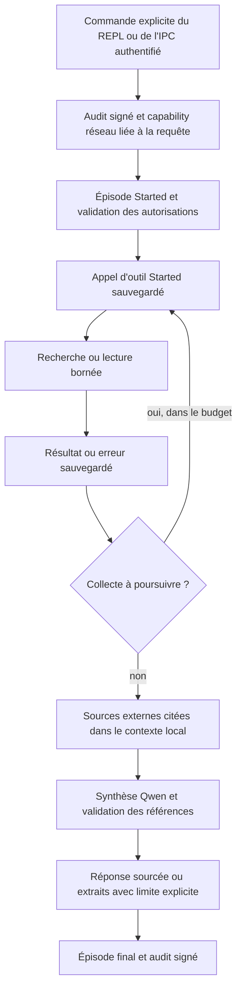

# Harness de raisonnement et de recherche

Cette page décrit le chemin exécuté par le démon. Le harness est une boucle
bornée de recherche et de lecture, intégrée aux instructions, à l'inférence
locale, au journal épisodique et à l'audit. Il ne transforme pas un plan produit
par un LLM en une preuve d'exécution.

## Instructions et raisonnement

`hakille-kernel/src/instructions.rs` fournit la politique système commune à
S1 et S2 : autorisations et Constitution, demande actuelle, puis données
citées. Une source externe ou un souvenir ne peut pas remplacer cette
politique. La date UTC est explicite ; une date de consultation ne prouve pas
la date de publication ni l'actualité d'un contenu.

Le formateur ChatML de l'inférence neutralise les délimiteurs spéciaux venant
des données avant la tokenisation. Cette frontière de protocole empêche de
créer un rôle `system` en collant des marqueurs dans une page ou un prompt.
Ce n'est pas une garantie d'immunité sémantique aux injections : les outils,
leurs arguments et les autorisations restent contrôlés hors du LLM.

S1 et S2 transmettent une échéance au décodeur Qwen. Le moteur la vérifie avant
le préfill, entre ses blocs de 16 tokens et entre les tokens de sortie ;
il ne peut pas interrompre une opération matricielle déjà en cours ou le chargement d'un artefact. Le timeout externe
reste un filet de sécurité. S2 respecte également `HAKILLE_QWEN_MAX_TOKENS`.

Le seul provider S2 implémenté est actuellement `LocalGguf`. Une sélection
Ollama ou cloud renvoie une erreur explicite ; elle ne lance plus Qwen local
sous le nom du fournisseur demandé. Aucun jeton réseau n'est créé par le
raisonneur ou le planificateur quand l'appelant n'en fournit pas.

Le coût API de Qwen local est zéro ; cela ne mesure pas l'énergie ou le coût
matériel. Les frais éventuels de Brave/SearXNG ne sont pas mesurés et sont
signalés séparément du coût d'inférence. Sa confiance 0,75 reste une heuristique **non calibrée**, pas une
probabilité de vérité. La mémoire n'est combinée qu'une fois par le noyau.
La réflexion S2 garde ses étapes à l'état de propositions sans reçus ; les
`StepReceipt` vérifient les identifiants, l'unicité et la présence d'une
référence de preuve. Ils n'augmentent pas artificiellement la confiance du
modèle. Une autocritique indisponible ne devient plus une autorisation.

## Parcours d'une recherche



Les commandes suivantes sont disponibles dans le REPL et dans la saisie de
requêtes du HUD/IPC, ainsi qu'avec `--eval-prompt` :

```text
:research nouveautés Rust 1.95 documentation officielle
:read-web https://www.rust-lang.org/
```

`:read-web` restitue les extraits effectivement lus sans charger de modèle.
`:research` orchestre recherche, lecture puis synthèse locale avec contrôle des
références. Cette séparation évite de payer une inférence pour une simple lecture.

Le préfixe explicite est la demande de sortie réseau. Le démon utilise la
racine de capabilities déjà chargée au boot, y compris depuis le trousseau OS.
Le jeton est limité à Network/Execute, à deux minutes, à l'audience du noyau,
à un nonce et à l'empreinte SHA-256 de la requête typée exacte. Le noyau
recontrôle ces droits avant chaque outil, y compris après l'écriture de sa
trace. Une recherche sans capability ou une requête différente est refusée.

Seuls le texte fourni après `:research` et les URLs à lire sont envoyés sur le
réseau. Les souvenirs personnels, le contexte et les réponses précédentes ne
sont pas ajoutés à la requête du fournisseur. Le modèle ne choisit pas d'outil
supplémentaire à partir du contenu d'une page. Les commandes d'exécution
métier et leurs confirmations restent distinctes.

La recherche récupère au plus cinq liens HTTPS, déduplique les fragments,
lit jusqu'à trois pages et essaie les liens suivants lorsqu'une page échoue.
Une erreur transitoire (connexion, timeout, HTTP 429/5xx) permet une seule
reprise, elle aussi comptée dans le budget. Les refus, formats invalides et
HTTP 4xx ordinaires ne sont pas rejoués.

Les budgets par défaut sont :

| Limite | Valeur |
|---|---|
| Argument utilisateur | 2 048 octets |
| Appels d'outils, reprises comprises | 6 |
| Pages retenues | 3 |
| Délai par appel d'outil | 8 secondes |
| Budget de collecte | 30 secondes |
| Redirections par lecture | 3, contrôlées individuellement |
| Réponse HTTP | 1 Mio, vérifié dans les en-têtes et pendant la lecture |
| Texte extrait d'une page | 80 000 caractères maximum |
| Extrait retenu par source | 2 000 caractères, centré sur les termes recherchés |

Six appels d'outils ne signifient pas six requêtes HTTP : une lecture peut
suivre jusqu'à trois redirections. La synthèse locale possède son budget LLM
séparé. Les commits sont synchrones ; le budget est recontrôlé après chacun,
sans prétendre interrompre une écriture disque au milieu d'une transaction.
Une collecte `Complete` désigne la fin du plan borné, pas une couverture
exhaustive du Web.

## Configuration réseau

Aucun moteur de recherche tiers n'est choisi implicitement. Configurer **un**
fournisseur avant de démarrer le démon :

```bash
# Brave Search : clé fournie par votre environnement, jamais versionnée.
export HAKILLE_BRAVE_API_KEY="$MY_BRAVE_SEARCH_KEY"

# Ou SearXNG : URL de l'endpoint /search avec le format JSON activé.
export HAKILLE_SEARXNG_URL="https://search.example.org/search"
```

Ne pas définir les deux variables simultanément. Un SearXNG auto-hébergé peut
utiliser `http://127.0.0.1:8080/search` ; HTTP est réservé à la boucle locale.
Cet endpoint est une configuration administrateur de confiance, pas une URL
choisie par une page. Sans fournisseur, `:research` échoue explicitement ;
`:read-web` reste utilisable.

Les lectures web acceptent uniquement HTTPS sur le port 443, sans identifiants
URL. Chaque destination et chaque redirection passent les contrôles d'adresses
publiques, y compris les IPv4 encapsulées en IPv6. Les adresses DNS sont épinglées
au client HTTP en transport direct, pour réduire le risque de rebinding.
Les cookies, l'authentification de navigateur et les proxies ambiants sont
absents de ce chemin. La clé Brave n'est envoyée qu'à son endpoint, sans
suivre ses redirections.

Un environnement qui exige un proxy peut le configurer explicitement :

```bash
export HAKILLE_RESEARCH_PROXY="$HTTPS_PROXY"
# Seulement si une autorité privée de confiance est nécessaire :
export HAKILLE_RESEARCH_CA_BUNDLE="/chemin/vers/autorites-de-confiance.pem"
```

Ce choix est affiché au boot, dans les résultats et dans les traces. Les URLs
et le DNS local restent contrôlés ; **la résolution et la connexion finales
sont alors déléguées au proxy de confiance**. L'épinglage DNS direct ne garantit
pas la destination vue par ce proxy. La validation TLS reste active ; aucune
option de contournement des certificats n'est ajoutée.

## Sources, synthèse et mémoire

Les pages sont parsées avec `scraper`/html5ever. Les scripts, styles, templates
et éléments portant `hidden` ou `aria-hidden=true` sont exclus ; aucun JavaScript n'est exécuté.
Seuls HTML, XHTML et texte UTF-8 sont pris en charge. Les limites de parsing,
la troncature et les erreurs restent visibles.

Une source contient un ID `[S1]`, son URL finale, son titre, l'heure de lecture,
l'empreinte SHA-256 du corps reçu et l'extrait sélectionné. Un résultat de
moteur de recherche n'est jamais présenté comme une page effectivement lue.
La synthèse doit citer au moins une source lue, ne citer aucun ID inconnu et
ne produire aucune URL libre. Les liens vérifiés sont ajoutés par le harness.
La validation des références **ne prouve pas que chaque affirmation découle
de la source**, ni que la source dit vrai.

Si la synthèse échoue ou ne respecte pas ce contrat, le résultat indique
« Synthèse non validée » et fournit les extraits obtenus. Aucune réponse LLM
provisoire n'est diffusée avant ce contrôle. Si aucune page n'est obtenue, le
tour échoue et l'épisode conserve la cause et les tentatives. Le REPL poursuit
la session ; le mode d'évaluation signale l'échec.

Chaque tentative est sauvegardée avant et après l'effet réseau. Un arrêt laisse
un état `Started` inspectable, sans inventer de succès. Un problème de stockage
interrompt la boucle avant l'appel suivant. Le champ optionnel `tool_trace` des
épisodes conserve les extraits, les échecs et les sources ; les anciennes bases
restent lisibles grâce à la valeur par défaut de ce champ.

Le rappel ultérieur peut retrouver ces sources et les marque comme **archives
externes datées**, pas comme faits utilisateur ni comme vérification actuelle.
L'oubli d'un épisode efface également sa trace. L'oubli d'un fait examine les
textes de sources archivés en plus des prompts, réponses et références. Cela
reste une suppression logique, avec les limites décrites dans
[MEMORY_END_TO_END.md](MEMORY_END_TO_END.md).

Inspection dans le REPL :

```text
:episodes Rust
:research-trace
:research-trace <UUID-épisode>
:forget-episode <UUID-épisode>
```

La trace complète reste dans la mémoire mutable. L'audit signé conserve la
demande réseau et les métadonnées de résultat (épisode, statut, nombre d'appels,
empreintes des sources), sans recopier les pages complètes. Les règles
historiques du journal d'audit indépendant restent applicables.

## Limites actuelles

- Le parcours est une recherche déterministe, pas un agent universel qui
  reformule librement, navigue sur des sites privés ou exécute des instructions
  trouvées sur le Web.
- Aucun accès à des comptes, cookies, paywalls, PDF, JavaScript ou téléchargement
  arbitraire de fichiers ; pas d'envoi de messages ni de mutation distante.
- Pas de reprise automatique des appels `Started` après crash : la trace est
  inspectable, une nouvelle commande est nécessaire. Les sources externes ne
  sont pas rafraîchies silencieusement.
- La qualité du petit modèle Qwen et du rappel MiniLM reste limitée. Les
  références, les empreintes et les tests de contrôle n'établissent pas une
  compréhension de niveau AGI ou une vérité exhaustive.

Le diagnostic et le plan sont dans [HARNESS_REDESIGN.md](HARNESS_REDESIGN.md).
Les résultats exécutés sont consignés dans [HARNESS_VALIDATION.md](HARNESS_VALIDATION.md).
