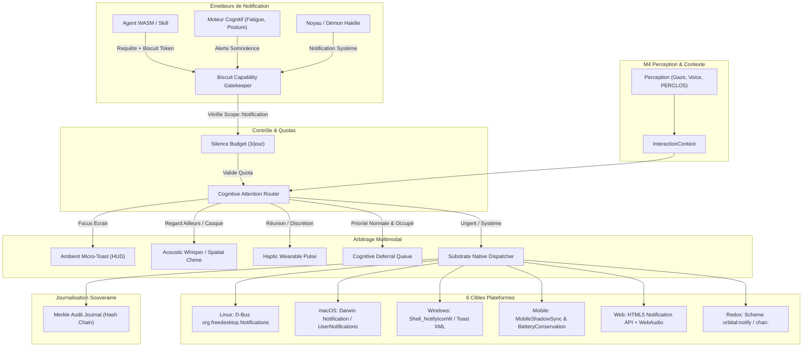

# SPÉCIFICATION D'ARCHITECTURE : SYSTÈME DE NOTIFICATIONS MULTI-PLATEFORME SOUVERAIN (HAKILLE SMNF)

> **Projet** : Hakille Sovereign Personal AI OS  
> **Composant** : Hakille Sovereign Multimodal Notification Fabric (SMNF)  
> **Statut** : En cours de déploiement (M1 à M7)  
> **Périmètre** : Linux, macOS, Windows, Mobile (Android/iOS), Web (WASM), Redox OS  
> **Conformité** : ADR-001 (Pur Rust), Règle 7 (Mineurs), Règle 8 (Souveraineté matérielle), Règle 11 (Oubli éphémère), Spec §18/§29 (Budget de silence)

---

## 1. Vision et Principes Directeurs

Dans Hakille, une notification n'est **ni un panneau publicitaire, ni une intrusion permanente**. Conformément à la philosophie du système (*« L'interface qui n'existe presque pas »*), le système de notification applique 5 piliers :

1. **Contrôle Cryptographique par Capability Biscuit v5** : Aucun agent WASM, démon ou processus externe ne peut émettre de notification sans détenir un jeton `CapabilityScope::Notification` signé par l'autorité racine du système.
2. **Arbitrage Cognitif de l'Attention (Vision & Audio M1-M6)** : La notification adapte son mode d'expression selon que l'utilisateur regarde l'écran (Gaze tracking), porte un casque, est en réunion, ou présente des signes de fatigue (PERCLOS).
3. **Respect du Budget de Silence (Spec §18/§29)** : Maximum 3 interventions autonomes inférées par le système par jour. Les notifications non urgentes sont différées (*Cognitive Deferral*) jusqu'à une transition naturelle d'activité.
4. **Sanctuarisation de l'Accent Braise `#FF7A2F`** : Seules les notifications exigeant une décision humaine irréversible (`DecisionRequired`) ont le droit d'arborer l'accent Braise. L'œil humain sait immédiatement qu'une action est requise.
5. **Couverture Multi-Plateforme Native Réelle** : Dispatch honnête et direct sur les 6 cibles (FreeDesktop D-Bus sur Linux, AppleScript/Darwin sur macOS, Shell_NotifyIcon/Toast sur Windows, file d'ombre sur Mobile, Notification API sur Web, Schemes sur Redox).

---

## 2. Architecture des Flux et Composants

---

## 3. Matrice des Cibles Substrate et Comportements

| Plateforme | Crate | Mécanisme Natif | Comportement en Mode Sans Écran / Headless |
| :--- | :--- | :--- | :--- |
| **Linux** | `hakille-substrate-linux` | D-Bus `org.freedesktop.Notifications` (`Notify`) | Journalisation locale sécurisée dans le log de session |
| **macOS** | `hakille-substrate-macos` | Darwin Notification Center / `osascript` | Émission sur le flux standard système |
| **Windows** | `hakille-substrate-windows` | `Shell_NotifyIconW` (NIM_ADD / Ballon) & WinRT Toast | Enregistrement dans le journal Windows Event / Substrate |
| **Mobile** | `hakille-substrate-mobile` | `MobileShadowSync` avec batching et veille Doze | Sauvegarde locale persistée avec réveil sur ACK |
| **Web** | `hakille-substrate-web` | HTML5 `window.Notification` + carillon `WebAudioBridge` | Alerte visuelle canvas dans l'onglet actif |
| **Redox** | `hakille-substrate-redox` | Scheme micro-noyau `orbital:notify` ou `chan:` | File de messages noyau RedoxFS |

---

## 4. Jalons d'Ingénierie M1 à M7

- **Jalon N1** : Définition de `CapabilityScope::Notification` dans `hakille-core` avec validation Biscuit v5.
- **Jalon N2** : Modèles de données dans `hakille-substrate` (`NotificationRequest`, `NotificationUrgency`, `NotificationAction`, `NotificationHandle`).
- **Jalon N3** : Implémentation du trait `Substrate` sur les 6 plateformes.
- **Jalon N4** : Routeur d'attention contextuelle et intégration avec le `ChannelSelector` et la perception cognitive (M4).
- **Jalon N5** : Extension du protocole IPC `hakille-ui-protocol` et gestionnaire de notifications dans `hakille-daemon`.
- **Jalon N6** : HUD Desktop et composant de toast moderne auto-évaporant avec accent Braise.
- **Jalon N7** : Validation complète, suite de tests de stress et push GitHub.
